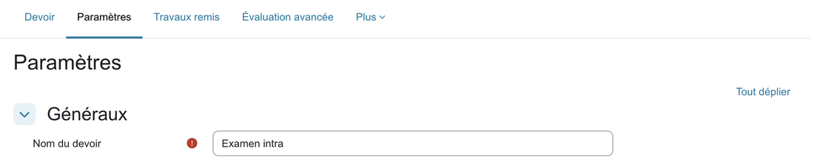
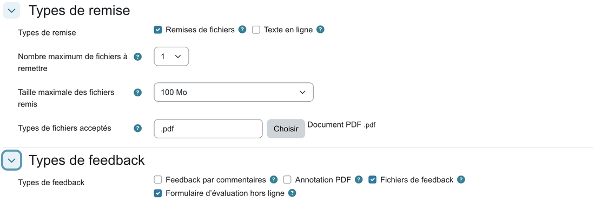
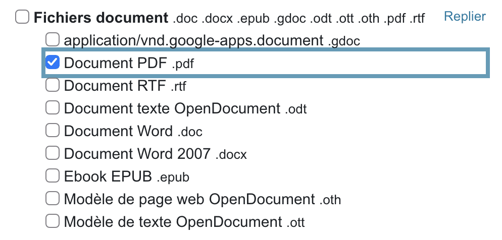
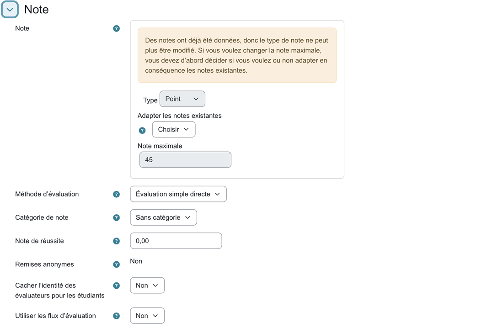

# 1. Préparer le devoir Moodle

rmn échange avec Moodle par l'activité **Devoir**. Il en lit le *formulaire d'évaluation* (un csv avec un étudiant par ligne) et y renvoie les notes et les copies corrigées. Créez le devoir avant l'examen, ou au plus tard avant de créer la tâche dans rmn.

Dans votre cours : **Mode d'édition**, puis **Ajouter une activité ou ressource** → **Devoir**. Pour un devoir existant, ouvrez-le puis l'onglet **Paramètres**.

> Les libellés sont ceux du Moodle de Polytechnique. Ils peuvent varier légèrement sur un autre Moodle.

## Les réglages du devoir

| Section | Réglage | Valeur | Pourquoi |
|---------|---------|--------|----------|
| Généraux | Nom du devoir | par ex. « Examen final » | – |
| Disponibilité | Autoriser la remise dès le, Date limite | cas A : la fenêtre de dépôt ; cas B : sans importance | – |
| Types de remise | Remises de fichiers | cas A : **coché** ; cas B : décoché | cas A : les étudiants déposent leur copie |
| Types de remise | Nombre maximum de fichiers à remettre | **1** | rmn traite chaque PDF comme une copie : un étudiant qui dépose deux fichiers aurait deux copies |
| Types de remise | Types de fichiers acceptés | **.pdf** (**Choisir** → Fichiers document → Document PDF) | rmn ne lit que des PDF |
| Types de feedback | Fichiers de feedback | **coché** | pour renvoyer à chaque étudiant sa copie corrigée |
| Types de feedback | Formulaire d'évaluation hors ligne | **coché** | c'est le csv que rmn lit et remplit |
| Types de feedback | Feedback par commentaires, Annotation PDF | au choix | rmn ne s'en sert pas |
| Note | Type | **Point** | rmn écrit une note en points |
| Note | Note maximale | **le total de l'examen** (bonus compris s'il y en a) | Moodle refuse une note plus grande que le maximum |
| Note | Remises anonymes | **Non** | rmn a besoin du nom et du matricule de chaque étudiant |
| Note | Utiliser les flux d'évaluation | **Non** | les notes importées sont alors directement celles du devoir |
| Réglages courants | Mode de groupe | au choix | une colonne « Groupe » du csv sert à trier les copies par groupe |

Pour n'accepter que des PDF, **Choisir** ouvre la liste des types de fichiers : dépliez **Fichiers document** et cochez **Document PDF**.

Enregistrez avec **Enregistrer et afficher**.

## Le matricule doit être visible

rmn associe chaque copie à un étudiant par son **matricule**. La colonne `Matricule` doit donc figurer dans le formulaire d'évaluation. Sur le Moodle de Polytechnique, elle y est : l'onglet **Travaux remis** du devoir affiche une colonne **Matricule** à côté du nom. Sur un autre Moodle, si cette colonne manque, demandez à l'administrateur d'ajouter le matricule (numéro d'identification) aux *champs d'identité* affichés aux enseignants.

## Cas A ou cas B ?

- **Cas A** : les étudiants numérisent leur copie (avec un téléphone ou un scanner) et la déposent dans le devoir. Vous récupérez toutes les copies d'un coup (voir [Récupérer les fichiers Moodle](04-fichiers-moodle.md#cas-a--le-zip-des-travaux-remis)).
- **Cas B** : vous ramassez les copies papier et les numérisez vous-même. Le devoir n'a pas besoin de remise de fichiers, mais il doit quand même exister : c'est lui qui fournit la liste des étudiants (le csv) et qui recevra les notes.

Suite : [2. Préparer l'examen](02-examen.md).
