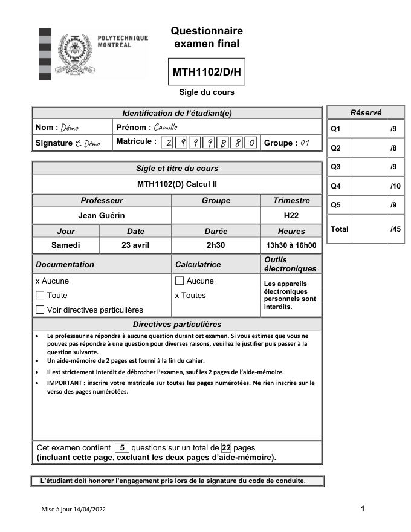

# 2. Préparer l'examen

rmn a besoin de trouver deux choses sur chaque copie :

1. **le matricule**, écrit à la main par l'étudiant dans une rangée de 7 cases ;
2. pour chaque question, **la page où le correcteur écrit la note**.

## La page de garde

La première page de chaque copie est la **page de garde**. Elle porte les cases du matricule et un tableau avec une case de note par question. rmn fournit un modèle prêt à l'emploi : le template « Example: Page de couverture », ajouté à chaque nouveau compte.

- Le matricule s'écrit **un chiffre par case**, sans déborder.
- Le tableau « Réservé » de droite reçoit les notes, une case par question. À la finalisation, rmn y écrit les notes validées.

Vous pouvez utiliser votre propre page de garde. Elle doit garder une rangée de 7 cases pour le matricule et une case de note par question ; il suffira de [créer un template](03-template.md) qui indique où elles se trouvent.

## Les pages suivantes

Après la page de garde, chaque question occupe **un nombre fixe de pages**, le même pour toutes les copies (par exemple Q1 : 2 pages, Q2 : 1 page…). C'est ce qui permet à rmn de découper les copies par question. Demandez aux étudiants de ne pas arracher de page et de ne pas en ajouter : une copie qui n'a pas le bon nombre de pages est mise de côté (voir [Suivre la tâche](06-suivi.md#copies-à-rectifier)).

Si le haut de chaque page porte aussi des cases « Matricule » (comme dans le template « Example: Page intérieure »), rmn s'en sert pour confirmer le matricule de la page de garde.

## Numériser les copies (cas B)

- **Un PDF par copie**, pages dans l'ordre, page de garde en premier. La plupart des numériseurs savent séparer les copies automatiquement (par exemple avec une feuille de séparation, ou un nombre fixe de pages par document).
- 200 à 300 ppp, en noir et blanc ou en niveaux de gris, suffisent.
- Le nom des fichiers n'a pas d'importance. Si le matricule figure dans le nom du fichier (par exemple `Dupont_1234567.pdf`), rmn le prend directement.
- Mettez tous les PDF dans **un seul fichier .zip**.

Dans le cas A, ce sont les étudiants qui numérisent : rappelez-leur de déposer **un seul PDF** contenant toutes les pages, dans l'ordre.

Suite : [3. Créer un template](03-template.md).
