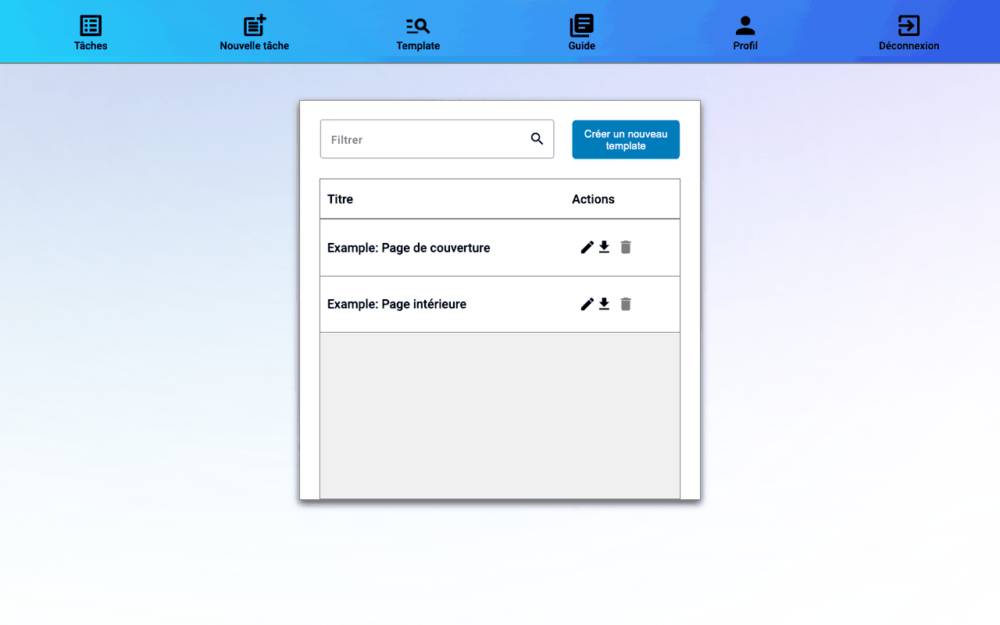
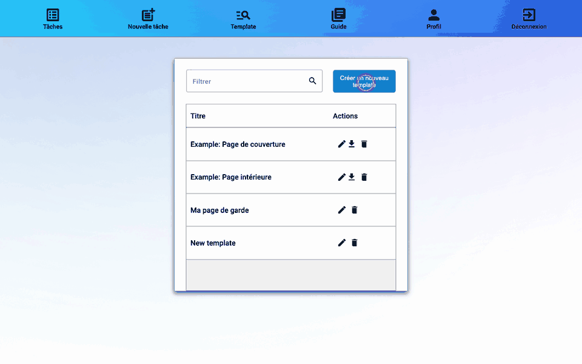

# 3. Créer un template

Un **template** dit à rmn où se trouvent, sur une page, les cases du matricule et les cases de notes. Il se crée une seule fois par modèle de page et se réutilise d'un examen à l'autre.

Chaque compte reçoit deux templates d'exemple :

| Template | Pour | Zones |
|----------|------|-------|
| Example: Page de couverture | la page de garde par défaut | Identification + Questions |
| Example: Page intérieure | les pages suivantes, cases « Matricule » en haut à droite | Identification |

Si vous utilisez ces pages, passez directement à l'[étape 4](04-fichiers-moodle.md).

## Ouvrir l'éditeur

Menu **Template** → **Créer un nouveau template**. Glissez-déposez le PDF de votre page (un examen vierge suffit), indiquez quelle page de ce PDF sert de modèle, puis cliquez sur **Confirmer**.

## Dessiner les zones

1. Donnez un **nom** au template.
2. Choisissez l'outil **Rectangles**.
3. Cliquez sur **Identification**, puis tracez un rectangle qui englobe exactement la rangée des 7 cases du matricule, avec une petite marge, sans le mot « Matricule » ni les champs voisins.
4. Pour une page de garde, cliquez sur **Questions**, puis tracez un rectangle autour de la **colonne des cases où s'écrivent les notes**, de la première question jusqu'à la case du total comprise. Laissez dehors les libellés (Q1, Q2…) et les maximums (/9, /8…) : seules les cases de note doivent être dans le rectangle.
5. **Selection** déplace ou redimensionne un rectangle ; **Supression** l'efface.
6. **Confirmer** enregistre le template et lance la reconnaissance des cases (voir ci-dessous).

## Vérifier la reconnaissance

Après **Confirmer**, rmn essaie de reconnaître les cases dans chaque rectangle, comme il le fera sur les copies. Quand c'est fait (« Le template a été mis à jour »), il **encadre en rouge chaque case reconnue** et affiche le **Nombre de questions** : les cases du rectangle Questions, moins celle du total.

Vérifiez que :

- les 7 cases du matricule sont encadrées en rouge, une par une ;
- chaque case de note est encadrée en rouge, total compris ;
- le Nombre de questions correspond à votre examen.

Si une case n'est pas encadrée, ou si un encadré déborde sur un libellé, ajustez le rectangle avec **Selection** et confirmez à nouveau. Une case que rmn ne reconnaît pas sur le template ne sera pas lue non plus sur les copies.

> Un template partagé par l'administrateur est en lecture seule (« Ce template est en lecture seule. ») : pour l'adapter, créez un nouveau template à partir du même PDF.

Un template peut avoir plus de cases de notes que l'examen n'a de questions : les cases en trop seront marquées « Ignorer » à la création de la tâche.

Suite : [4. Récupérer les fichiers Moodle](04-fichiers-moodle.md).
