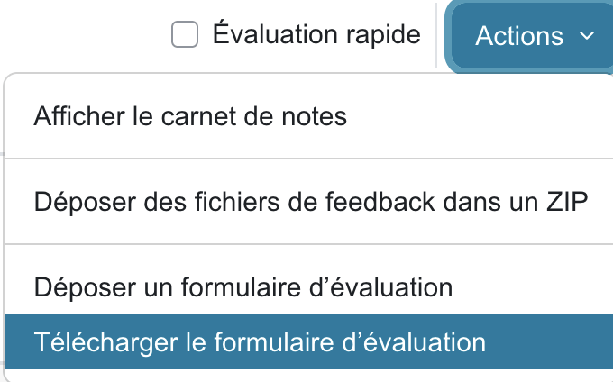

# 4. Récupérer les fichiers Moodle

Après l'examen, ouvrez le devoir Moodle, puis l'onglet **Travaux remis**. Toutes les actions ci-dessous se trouvent dans le menu **Actions**, en haut à droite de la liste des étudiants.

## Le formulaire d'évaluation (csv)

**Actions** → **Télécharger le formulaire d'évaluation**.

Le fichier contient une ligne par étudiant. rmn utilise les colonnes suivantes :

| Colonne | Rôle dans rmn |
|---------|---------------|
| `Matricule` | **obligatoire**, associe une copie à un étudiant |
| `Nom complet` | **obligatoire**, affiché pendant la vérification des matricules, sert à nommer les copies |
| `Identifiant` | `Participant…` : Moodle s'en sert pour réimporter les notes et les copies |
| `Statut` | les étudiants ayant remis passent en premier dans le csv final |
| `Note`, `Note maximale`, `Dernière modification (note)` | remplies par rmn à la finalisation |
| `Groupe` (facultative) | trie les copies par groupe (tout nom de colonne qui finit par *gr*, *groupe* ou *groupes*) |

**Ne modifiez pas ce fichier** : ne renommez pas les colonnes et ne retirez pas de ligne. Un csv ouvert puis enregistré dans Excel avec des `;` comme séparateur est accepté.

> Les étudiants inscrits après le téléchargement n'y figurent pas. Vous pourrez [remplacer le csv](06-suivi.md#ajouter-des-copies-ou-remplacer-le-csv) plus tard.

## Cas A : le zip des travaux remis

**Actions** → **Télécharger tous les travaux remis** (l'entrée apparaît quand des étudiants ont remis un fichier). Moodle produit un `.zip` avec un dossier par étudiant (`Nom complet_Participant…_assignsubmission_file_`). Téléversez ce zip tel quel dans rmn, sans le décompresser.

## Cas B : vos numérisations

Utilisez le `.zip` de vos PDF ([voir Préparer l'examen](02-examen.md#numériser-les-copies-cas-b)).

Suite : [5. Créer la tâche](05-nouvelle-tache.md).
