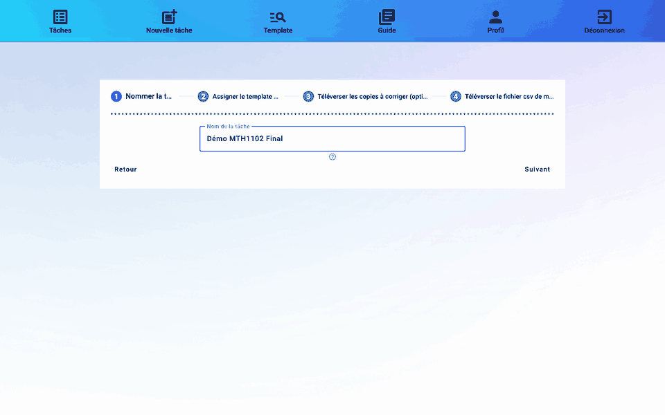
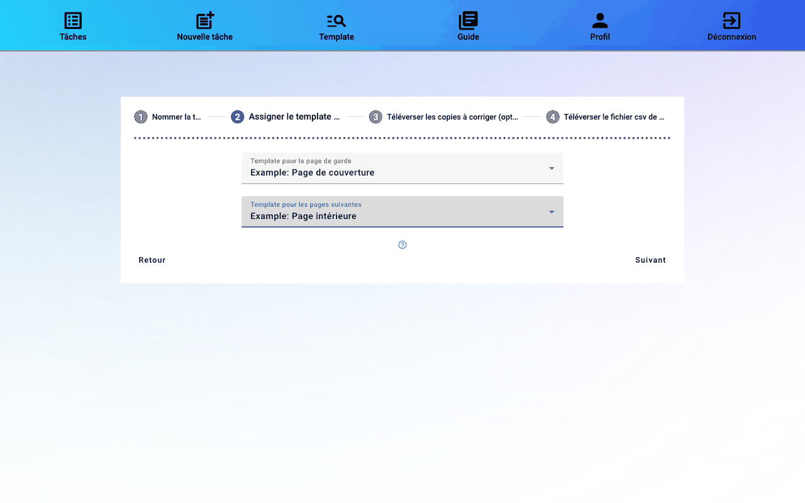
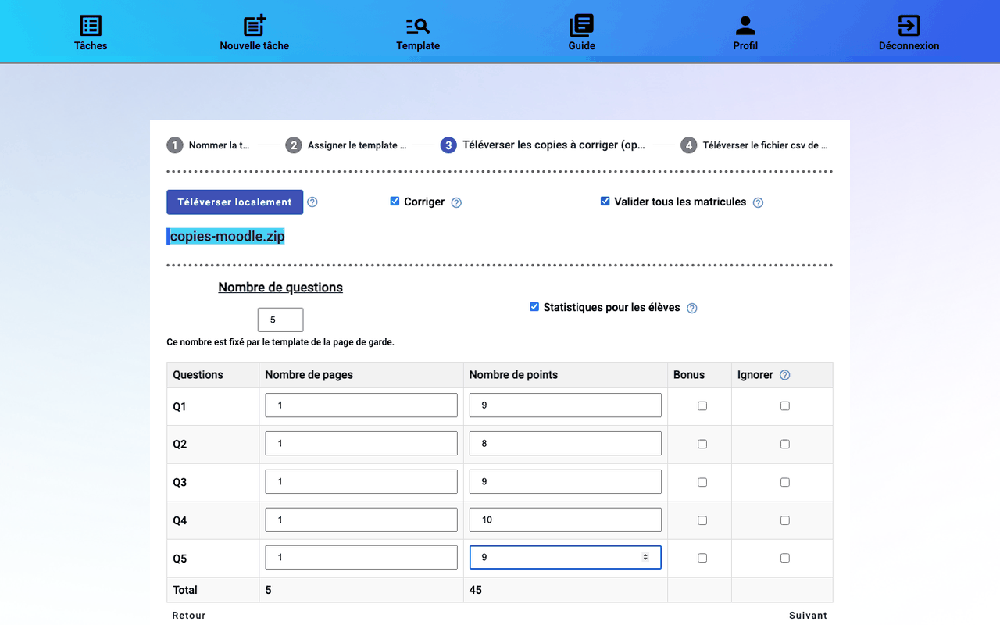
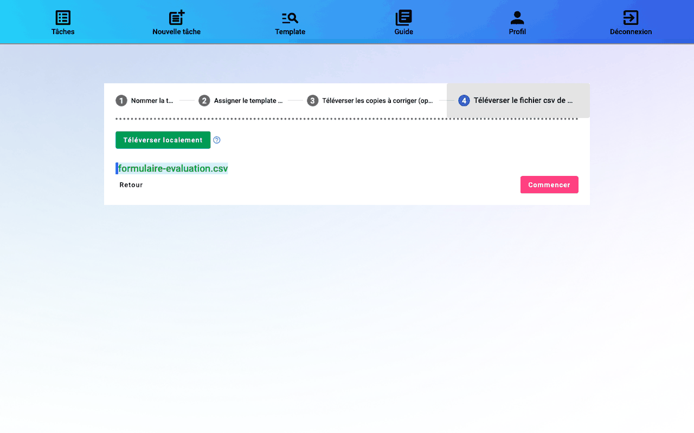

# 5. Créer la tâche

Une **tâche** regroupe tout ce qui concerne une évaluation : les copies, le csv, les notes. Menu **Nouvelle tâche**. L'assistant a quatre étapes ; **Suivant** et **Retour** permettent de passer de l'une à l'autre.

## Étape 1 : Nommer la tâche

Donnez un nom qui permet de retrouver la tâche dans la liste, par exemple « MTH1102 Final A26 ».

## Étape 2 : Assigner les templates

- **Template pour la page de garde** : en général « Example: Page de couverture ». Ce template fixe le nombre de questions.
- **Template pour les pages suivantes** : en général « Example: Page intérieure ». Il indique où lire le matricule sur les autres pages.

## Étape 3 : Téléverser les copies

**Téléverser localement** : choisissez le `.zip` des copies, soit celui de Moodle (cas A), soit vos numérisations (cas B). Cette étape est facultative : une tâche peut être créée sans copie, et les copies ajoutées ensuite.

### Corriger et valider tous les matricules

- **Corriger** (coché par défaut) : la tâche sert à noter. Décochez-la seulement pour renommer et trier des copies par matricule, sans notes.
- **Valider tous les matricules** : cochée, chaque matricule lu doit être confirmé à la main. Décochée, rmn valide de lui-même les matricules lus avec assurance, et vous ne vérifiez que les autres.

### Le tableau des questions

Une ligne par case de note du template de page de garde :

| Colonne | À saisir |
|---------|----------|
| Nombre de pages | combien de pages la question occupe dans chaque copie, page de garde non comprise. Le total doit correspondre au nombre de pages des copies moins 1 |
| Nombre de points | la note maximale de la question |
| Bonus | cochez si la note de cette question peut dépasser son maximum (question bonus) |
| Ignorer | la question n'existe pas dans cet examen (0 page, 0 point) : sa case reste vide sur la page de garde |

La ligne **Total** additionne pages et points. Le total des points doit être égal à la **Note maximale** du devoir Moodle.

**Statistiques pour les élèves** joint à la copie rendue de chaque étudiant un PDF avec ses notes, et la moyenne, l'écart-type et l'histogramme de chaque question.

## Étape 4 : Téléverser le csv de Moodle

**Téléverser localement** : choisissez le formulaire d'évaluation téléchargé du devoir ([voir étape 4 du guide](04-fichiers-moodle.md#le-formulaire-dévaluation-csv)). rmn vérifie que chaque ligne du fichier est bien formée.

Cliquez sur **Commencer** : les fichiers sont envoyés au serveur, puis la liste des tâches s'affiche.

> **Dupliquer** une tâche, depuis la liste des tâches ou son tableau de bord, ouvre cet assistant prérempli. Pratique pour un examen différé ou une autre section du même cours.

Suite : [6. Suivre la tâche](06-suivi.md).
