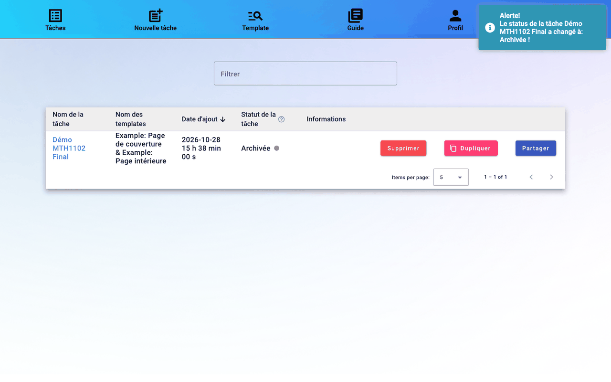
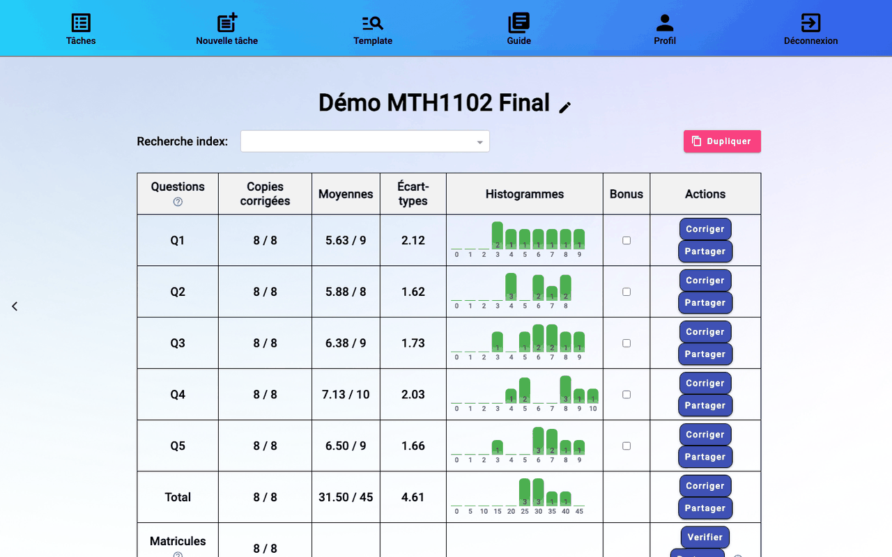

# 6. Suivre la tâche

## La liste des tâches

Menu **Tâches**. Chaque ligne affiche le nom de la tâche, ses templates, sa date et son statut (avec une pastille de couleur). Cliquez sur le nom d'une tâche pour ouvrir son tableau de bord. Chaque ligne a ses boutons **Supprimer**, **Dupliquer** (nouvelle tâche préremplie) et **Partager**.

## Les statuts

| Statut | Pastille | Ce qui se passe | À faire |
|--------|----------|-----------------|---------|
| En préparation | jaune | rmn découpe les copies par question | attendre (quelques minutes pour une centaine de copies) |
| Rectifier les pdf | orange | des copies n'ont pas le nombre de pages attendu | cliquer sur la tâche, voir [Copies à rectifier](#copies-à-rectifier) |
| Prêt à la correction | vert | les copies sont prêtes | corriger ([chapitre 8](08-correction.md)) |
| Prêt à la correction et traitement en cours des matricules | orange | rmn lit encore les matricules | vous pouvez déjà corriger |
| Prêt à la correction et vérification des matricules | bleu | des matricules attendent une vérification | [vérifier les matricules](07-matricules.md) |
| En attente d'être finalisé | jaune | – | [finaliser](09-finalisation.md) quand tout est corrigé |
| Finalisation en cours | vert | rmn écrit les notes sur les copies et prépare les fichiers | attendre |
| Archivée | gris | les fichiers finaux sont prêts | [télécharger](09-finalisation.md#télécharger-les-fichiers) |
| Erreur | rouge | un problème est survenu | l'icône ⓘ affiche le message |

La liste se met à jour d'elle-même : inutile de recharger la page.

## Copies à rectifier

Une copie qui n'a pas `1 + total des pages des questions` pages ne peut pas être découpée. Elle est mise de côté et la tâche passe à **Rectifier les pdf**. Cliquez sur la tâche pour ouvrir la fenêtre **Téléversement des fichiers** :

- la liste des copies refusées, chacune téléchargeable (ou toutes d'un coup avec **Télécharger tous les fichiers en ZIP**) ;
- après correction d'une copie (page manquante ajoutée, page blanche retirée…), glissez-la dans la zone de dépôt, puis **Continuer** ;
- **Ignorer et continuer** poursuit sans ces copies ;
- **Modifier le nombre de pages** corrige le tableau des questions, si l'erreur venait de là.

## Le tableau de bord

Une ligne par question :

- **Copies corrigées** : copies validées / total. Pendant la lecture automatique, « Lecture en cours : N % » puis « Notes lues : … ».
- **Moyennes**, **Écart-types**, **Histogrammes** : calculés sur les notes validées.
- **Bonus** : la question peut dépasser son maximum.
- **Corriger** ouvre les copies de la question ([chapitre 8](08-correction.md)).

**Corriger** sur la ligne **Total** ouvre toutes les questions ; le menu « Numéro de la question » passe de l'une à l'autre. La ligne **Matricules** compte les matricules confirmés ; **Verifier** ouvre leur vérification ([chapitre 7](07-matricules.md)).

Le crayon à côté du nom de la tâche permet de la renommer et de modifier ses paramètres (pages et points des questions). **Recherche index** choisit un étudiant : les pages de correction s'ouvriront sur sa copie.

## Partager la correction

**Partager**, sur la ligne d'une question, crée un lien qui permet de corriger cette question sans compte rmn. Pratique pour répartir les questions entre plusieurs correcteurs. Sur la ligne **Matricules**, le lien donne accès à la vérification des matricules. Le lien ne donne accès qu'à ce qui a été partagé.

## Ajouter des copies ou remplacer le csv

- **Copies additionnelles** : ajoute des copies arrivées plus tard (examen différé, copie retrouvée…), sans recréer la tâche.
- **Mettre à jour csv** : remplace le formulaire d'évaluation, par exemple si un étudiant s'est inscrit après son téléchargement. Retéléchargez-le de Moodle, puis déposez-le ici.

Suite : [7. Vérifier les matricules](07-matricules.md).
