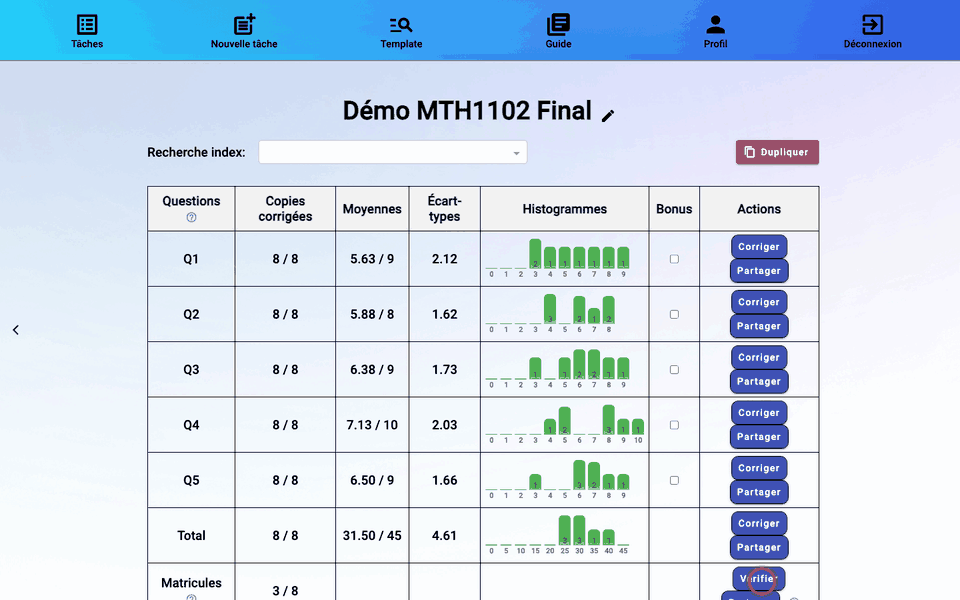

# 7. Vérifier les matricules

rmn lit le matricule écrit dans les cases et le cherche dans le csv de Moodle. Toutes les copies doivent être associées à un étudiant avant de [finaliser](09-finalisation.md). Depuis le tableau de bord, ligne **Matricules** → **Verifier**.

## Les couleurs des copies

La colonne de gauche liste les copies :

| Couleur | Signification |
|---------|---------------|
| vert | matricule confirmé |
| bleu | matricule lu avec assurance, à confirmer (plus la couleur tire vers le rouge, moins la lecture est sûre) |
| rouge | matricule douteux ou introuvable dans le csv : à vérifier |
| grisé | copie pas encore lue (« Pas encore lue ») |
| barré | copie supprimée |

Survolez une copie pour voir la confiance de la lecture.

## Confirmer un matricule

1. Regardez les cases du matricule sur la copie affichée.
2. Le champ **Matricule** propose l'étudiant trouvé, avec la confiance de la lecture. S'il est faux, tapez quelques chiffres du matricule ou une partie du nom, puis choisissez le bon étudiant dans la liste.
3. Validez avec le bouton ✓ ou la touche **Entrée**. La copie passe au vert et la suivante s'affiche.

Les flèches **←** et **→** passent d'une copie à l'autre (quand le curseur n'est pas dans le champ Matricule).

## Matricule utilisé par plusieurs copies

« Utilisé par plusieurs copies » signale qu'un même étudiant est associé à plus d'une copie. En général, l'une des deux a été mal lue : corrigez son matricule. S'il s'agit vraiment d'une copie en double (numérisée deux fois), supprimez-la avec la corbeille ; le bouton ↺ la rétablit.

## Étudiant absent du csv

Si l'étudiant n'apparaît pas dans la liste, il n'était pas inscrit au devoir quand le csv a été téléchargé. Retéléchargez le formulaire d'évaluation de Moodle, puis **Mettre à jour csv** dans le tableau de bord ([voir chapitre 6](06-suivi.md#ajouter-des-copies-ou-remplacer-le-csv)).

Suite : [8. Corriger les copies](08-correction.md).
