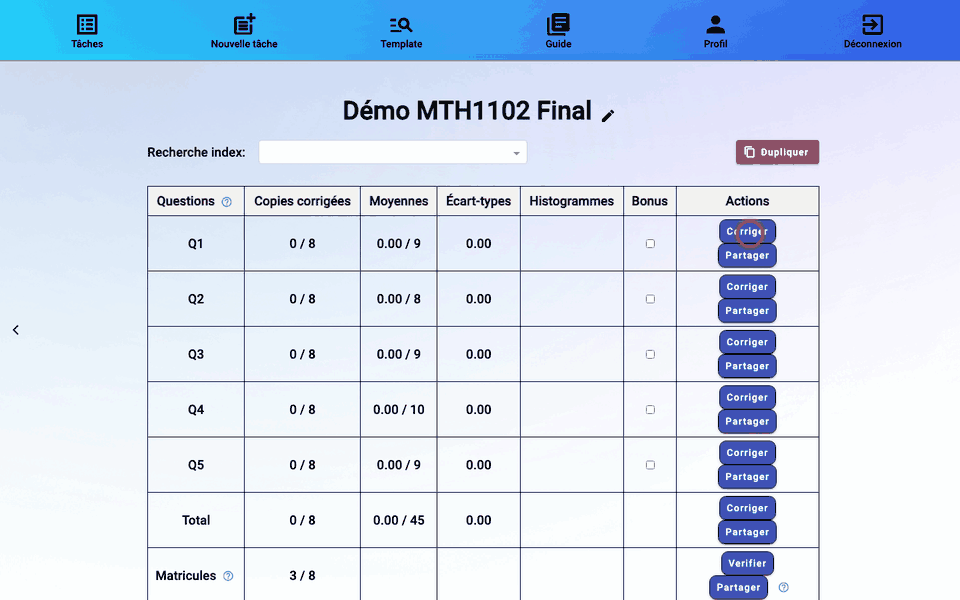

# 8. Corriger les copies

Depuis le tableau de bord, **Corriger** sur la ligne d'une question. Seules les pages de cette question s'affichent, copie après copie.



## Noter une copie

1. Lisez la réponse. Vous pouvez annoter la page avec la barre d'outils du lecteur : **texte**, **dessin** (crayon ou stylet), **gomme**, **annuler / rétablir**. Les annotations sont rendues à l'étudiant avec sa copie.
2. Tapez la note dans le champ **Note**, à côté du titre de la question (« Q2 (/10) »).
3. Validez avec le bouton ✓ ou la touche **Entrée** : la copie passe au vert et la suivante s'ouvre, le curseur déjà dans le champ Note.

Dans la vue **Total**, chaque question a son propre champ de note.

Les flèches de **Version** reviennent aux versions précédentes des annotations d'une copie ; ↺ rétablit la dernière.

## Lecture automatique des notes

Plutôt que de la taper, vous pouvez écrire la note **à la main sur la première page de la question** : avec l'outil dessin du lecteur (validez alors sans rien taper), ou dans les PDF annotés [hors ligne](#corriger-hors-ligne). rmn la lit et la propose dans le champ Note. Une note simple (`7`, `6.5`) ou une fraction du total (`6.5/9`) conviennent, entourées ou non. Une note proposée est encadrée de la couleur de sa confiance, et le survol du champ indique « Note lue automatiquement (confiance N %), à confirmer ». Elle ne compte qu'une fois confirmée par **Entrée** : relisez-la toujours.

Dans le tableau de bord, la colonne Copies corrigées affiche l'avancement de la lecture (« Lecture en cours : N % », puis « Notes lues : … »).

## Les couleurs des copies

| Couleur | Signification |
|---------|---------------|
| gris | non corrigée : pas de note et rien d'écrit sur la page |
| rouge | à confirmer, ou note en cours de lecture |
| bleu → rouge | note lue par rmn : bleu si la lecture est sûre, de plus en plus rouge sinon |
| vert | note validée |
| autres couleurs | copies marquées avec un bouton **Skip** |

Les boutons de couleur **Skip** marquent la copie affichée (par exemple « à revoir avec un collègue ») sans la valider. Masquez la colonne des copies (icône 👁) pour afficher le filtre par couleur.

S'il y a une colonne Groupe dans le csv, **Filtrer par groupe** limite la liste à un groupe.

## Raccourcis clavier

| Touche | Action |
|--------|--------|
| Entrée | valider la note et passer à la copie suivante |
| → / ← | copie suivante / précédente (hors du champ Note) |
| ↓ / ↑ | quatre copies plus bas / plus haut dans la grille |

## Notes au-dessus du maximum

Le tableau de bord signale « N note(s) > max » quand des notes validées dépassent le maximum de la question. Cliquez dessus pour n'afficher que ces copies et les corriger. Si le dépassement est voulu (question bonus), cochez **Bonus** pour cette question.

## Corriger hors ligne

**Gérer mes copies offline** permet de corriger sans connexion ou avec d'autres outils (tablette, logiciel d'annotation).

### Télécharger

**Tout télécharger** produit un zip des copies affichées :

- avec une question choisie dans **Numéro de la question**, le zip ne contient que cette question ;
- avec **Tout sélectionner**, il contient **toutes les questions d'un coup**, une par dossier.

Dans chaque dossier de question, les copies sont regroupées en PDF (au plus *Nombre max de copies par pdf* par fichier), avec un `notes.csv` des notes (colonnes Fichier, Index, Note) :

```
Examen.zip
├── Q1/
│   ├── Q1.pdf       copies 1 à 40
│   ├── Q1_1.pdf     copies 41 à 80
│   └── notes.csv
└── Q2/
    ├── Q2.pdf
    └── notes.csv
```

Chaque copie porte son numéro (« Copie N ») sur sa première page.

### Corriger

Annotez les PDF et écrivez la note à la main sur la première page de chaque copie, ou remplissez la colonne Note du `notes.csv`. N'ajoutez, ne retirez et ne réordonnez aucune page : rmn redécoupe les PDF en copies selon leur position.

### Téléverser

**Tout téléverser** : déposez un zip qui garde **la même structure qu'au téléchargement**, avec les mêmes noms de fichiers (`Q1.pdf`, `Q1_1.pdf`…, `notes.csv`). Les questions peuvent être renvoyées :

- **une par une** : un zip ne contenant que le dossier `Q1/`, puis plus tard un autre avec `Q2/`… ;
- **ensemble** : le zip complet, toutes les questions d'un coup.

Pour une question, il faut renvoyer tous ses PDF (`Q1.pdf` et `Q1_1.pdf`) : s'il en manque un au milieu, rmn ne remplace rien plutôt que d'attribuer des pages à la mauvaise copie.

Avec **Lire les notes annotées sur les copies**, rmn lit les notes écrites sur les pages ; une note saisie dans le csv l'emporte. Confirmez ensuite les notes proposées, comme en ligne.

Suite : [9. Finaliser et télécharger](09-finalisation.md).
