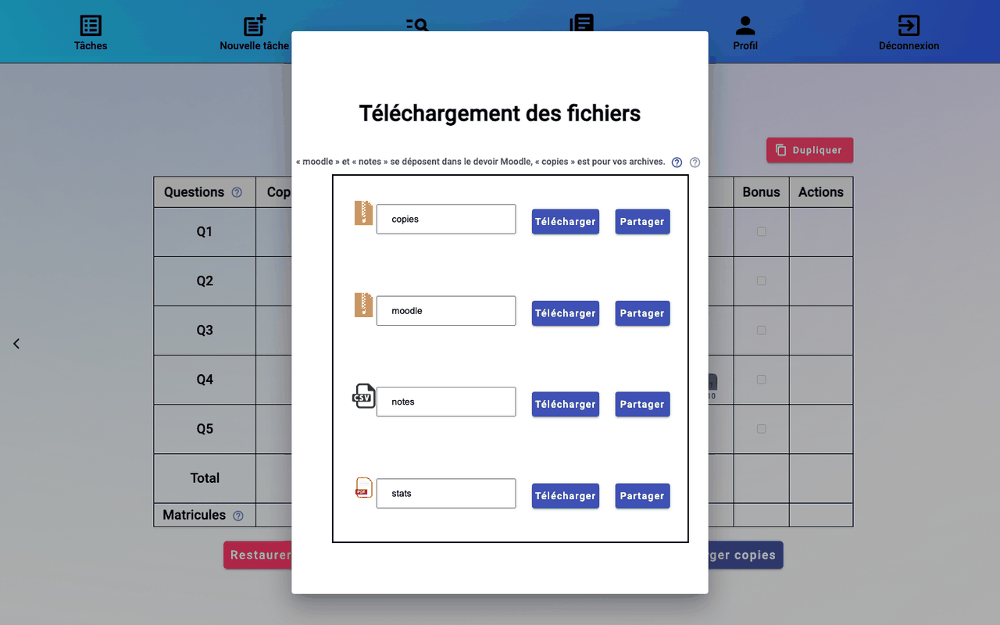

# 9. Finaliser et télécharger

## Finaliser

Quand toutes les copies sont corrigées et tous les matricules confirmés, cliquez sur **Finaliser** en bas du tableau de bord. Sinon, rmn indique ce qui manque (« Veuillez vérifier tous les matricules… » ou « Veuillez corriger toutes les copies… »).

La tâche passe à **Finalisation en cours**, puis à **Archivée**. Pendant ce temps, rmn :

- écrit les notes validées dans les cases de la page de garde ;
- rassemble chaque copie (page de garde, puis les pages de chaque question avec leurs annotations) en un seul PDF au nom de l'étudiant ;
- prépare, si l'option est cochée, le PDF de statistiques de chaque étudiant ;
- remplit le formulaire d'évaluation : une colonne par question, la **Note** totale et la date de modification.

## Les statistiques pour les élèves

**Statistiques pour les élèves**, à côté de **Finaliser**, joint à la copie corrigée de chaque étudiant un PDF (`…_notes.pdf`) avec ses notes par question, et la moyenne, l'écart-type et l'histogramme de chaque question. Décochée, les étudiants ne reçoivent que leur copie. L'option est reprise de la création de la tâche et peut être changée jusqu'à la finalisation. Elle commande aussi l'affichage de `stats.pdf` (les statistiques de l'examen, pour vous) parmi les fichiers à télécharger.

## Les étudiants sans copie

Un étudiant du formulaire d'évaluation sans copie notée (absent, ou copie supprimée) reçoit **0** par défaut. Pour des absences motivées, décochez **Note 0 aux étudiants sans copie**, à côté de **Finaliser**, avant de finaliser : leur note reste vide dans `notes.csv`, et l'import Moodle n'y touche pas. Le choix est enregistré avec la tâche.

> Une tâche archivée ne se modifie plus. **Restaurer** la rouvre, par exemple pour corriger une note, puis il faut finaliser à nouveau.

## Les pages de garde à vérifier

rmn écrit les notes dans les cases reconnues sur le template ([étape 3](03-template.md#vérifier-la-reconnaissance)), là où elles se trouvent sur chaque copie, même décalée, réduite ou tournée au scan. Quand il n'en est pas sûr, la tâche archivée l'indique dans la colonne **Informations** de la [liste des tâches](06-suivi.md#la-liste-des-tâches) : **N pages de garde à vérifier**. Un clic donne la liste de ces copies, avec la raison :

| Raison | Ce qui a été fait |
|--------|-------------------|
| cases introuvables sur la copie | les notes sont écrites à l'emplacement des cases du template |
| une case aux bords recouverts | la case, cachée par exemple par une note qui déborde, a été replacée d'après le template |
| cases trouvées sans le gabarit du template | le template a été enregistré avant que rmn retienne la position de ses cases, et son fichier n'a pas pu être relu : la colonne des notes peut être la mauvaise |
| cases introuvables | la page de garde est rendue sans les notes |

Ouvrez ces copies dans `copies.zip` pour voir où sont les notes. Seule la page de garde est en cause : `notes.csv` et les notes importées dans Moodle viennent des notes validées, pas de la page.

## Télécharger les fichiers

Sur la tâche archivée : **Télécharger copies**.

| Fichier | Contenu | Usage |
|---------|---------|-------|
| `moodle.zip` (et `moodle-2.zip`… au-delà de 500 Mo) | un dossier par étudiant, au format attendu par Moodle, avec sa copie corrigée (et ses statistiques, `…_notes.pdf`). Absent si le csv n'a pas d'identifiants Moodle (colonne Identifiant) | [déposer dans le devoir](10-retour-moodle.md#déposer-les-copies-corrigées) |
| `notes.csv` | le formulaire d'évaluation rempli ; un étudiant sans copie y a 0, ou une note vide si l'option est décochée | [importer dans le devoir](10-retour-moodle.md#importer-les-notes) |
| `copies.zip` | toutes les copies corrigées, triées par groupe s'il y en a ; avec, à côté de sa copie, les statistiques (`…_notes.pdf`) d'un étudiant sans identifiant Moodle | vos archives |
| `stats.pdf` | les statistiques de l'examen (proposé si **Statistiques pour les élèves** est cochée) | vos archives, ou à publier |

Le nom affiché dans chaque champ peut être modifié avant de cliquer sur **Télécharger**. **Partager** crée un lien de téléchargement pour un collègue.

Suite : [10. Rendre les notes sur Moodle](10-retour-moodle.md).
