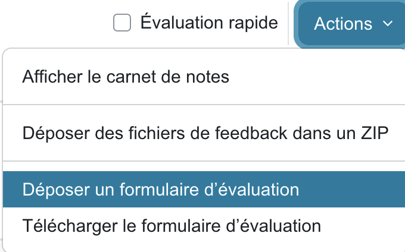
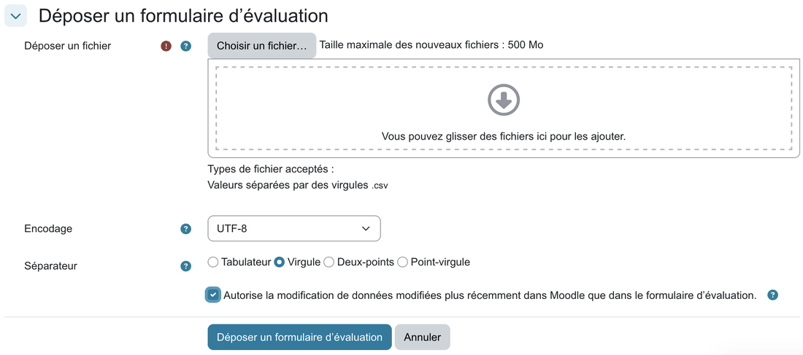
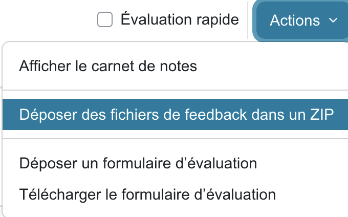
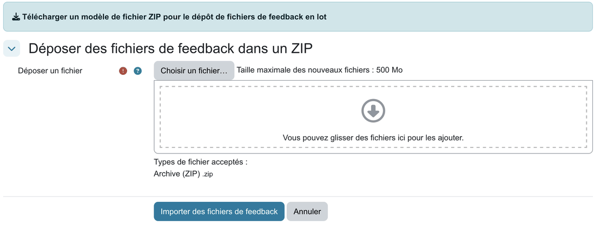

# 10. Rendre les notes sur Moodle

Retournez dans le devoir Moodle, onglet **Travaux remis**. Les deux imports se font avec le menu **Actions**.

## Importer les notes

1. **Actions** → **Déposer un formulaire d'évaluation**.

   

2. Déposez le `notes.csv` téléchargé de rmn. Laissez **Encodage** à UTF-8 et **Séparateur** à Virgule.
3. Cochez **Autorise la modification de données modifiées plus récemment dans Moodle que dans le formulaire d'évaluation** si des notes ont déjà été saisies dans Moodle pour ce devoir.

   

4. **Déposer un formulaire d'évaluation** : Moodle affiche la liste des notes qu'il va modifier. Vérifiez-la, puis confirmez.

Moodle associe chaque ligne à un étudiant par la colonne `Identifiant` et lit la colonne `Note`. Les colonnes Q1, Q2… ajoutées par rmn sont ignorées par Moodle, mais restent utiles dans vos archives.

> **Étudiants sans copie** : par défaut, rmn leur met **0**. Si des absences sont motivées, décochez **Note 0 aux étudiants sans copie** dans le tableau de bord de la tâche avant de [finaliser](09-finalisation.md#finaliser) : leur note reste alors vide dans `notes.csv`, l'import n'y touche pas, et vous saisissez dans Moodle celles qui doivent l'être.

## Déposer les copies corrigées

1. **Actions** → **Déposer des fichiers de feedback dans un ZIP**.

   

2. Déposez `moodle.zip` **tel quel**, sans le décompresser ni renommer ses dossiers : Moodle reconnaît chaque étudiant par le nom de son dossier. La taille maximale est de 500 Mo, comme les zip de rmn.

   

3. **Importer des fichiers de feedback** : Moodle liste les fichiers qu'il va associer à chaque étudiant. Confirmez.
4. S'il y a plusieurs zip (`moodle-2.zip`…), recommencez avec chacun.

## Publier

Vérifiez quelques étudiants dans l'onglet **Travaux remis** : la note et le fichier de feedback (la copie corrigée, et ses statistiques si l'option était cochée) doivent apparaître. Avec **Utiliser les flux d'évaluation** à Non (voir [chapitre 1](01-moodle.md#les-réglages-du-devoir)), les notes sont visibles dès l'import, selon les réglages du carnet de notes du cours.

C'est terminé. La tâche reste archivée dans rmn : vous pourrez retélécharger les fichiers, ou la **Dupliquer** pour l'examen suivant.
