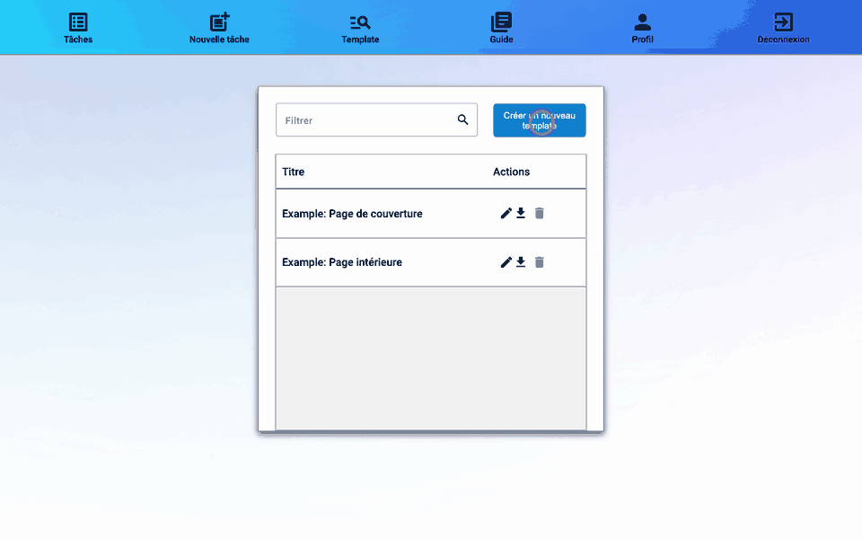

# Guide d'utilisation de rmn

rmn corrige des examens papier numérisés. Il lit le matricule de chaque copie, découpe les copies par question pour que chaque correcteur ne voie que la sienne, et propose les notes qu'il lit sur les copies. Il produit ensuite les fichiers à remettre dans un devoir Moodle : les notes et les copies corrigées.

Ce guide suit une évaluation du début à la fin. Il couvre deux cas :

- **Cas A, remise par les étudiants** : chaque étudiant dépose son PDF dans le devoir Moodle.
- **Cas B, numérisation par l'enseignant** : vous numérisez vous-même les copies papier. Le devoir Moodle sert alors seulement à recevoir les notes et les copies corrigées.

## Les étapes

| # | Où | Quoi | Résultat |
|---|----|------|----------|
| 1 | Moodle | [Préparer le devoir](01-moodle.md) | un devoir avec feuille d'évaluation hors ligne et fichiers de feedback |
| 2 | Papier | [Préparer l'examen](02-examen.md) | une page de garde avec les cases du matricule et des notes |
| 3 | rmn | [Créer un template](03-template.md) | rmn sait où lire matricules et notes (à faire une seule fois par modèle de page) |
| 4 | Moodle | [Récupérer les fichiers](04-fichiers-moodle.md) | le zip des copies et le csv « formulaire d'évaluation » |
| 5 | rmn | [Créer la tâche](05-nouvelle-tache.md) | les copies sont téléversées, lues et découpées |
| 6 | rmn | [Suivre la tâche](06-suivi.md) | la tâche est « Prêt à la correction » |
| 7 | rmn | [Vérifier les matricules](07-matricules.md) | chaque copie est associée à un étudiant |
| 8 | rmn | [Corriger les copies](08-correction.md) | chaque question de chaque copie a une note validée |
| 9 | rmn | [Finaliser et télécharger](09-finalisation.md) | le csv des notes et les zip des copies corrigées |
| 10 | Moodle | [Rendre les notes](10-retour-moodle.md) | les étudiants voient leur note et leur copie corrigée |

Les [questions fréquentes](11-faq.md) regroupent les problèmes courants.

## Aide dans l'application

Les icônes **?** à côté des champs de rmn résument la section du guide qui les concerne. Survolez une icône pour lire l'aide ; cliquez dessus pour ouvrir cette section dans un nouvel onglet.

Sur les boutons, l'aide apparaît au survol : une bulle explique ce que fait le bouton, et un petit **?** s'affiche dans son coin pour ouvrir la section du guide. Le guide complet est aussi accessible par le menu **Guide**.
